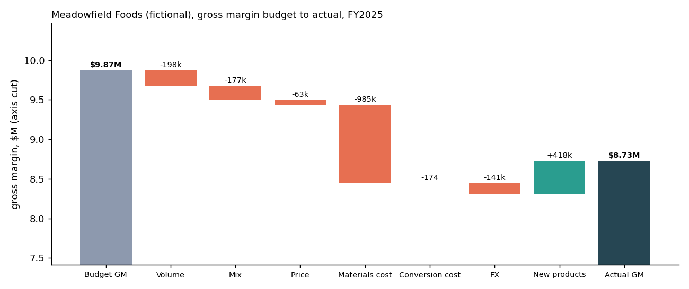

# Gross-margin variance attribution, from ERP extract to "why"

A weekly-close pipeline that takes raw ERP extracts, checks and reconciles them in SQL, and
explains every dollar of the gap between budget and actual gross margin by volume, mix, price,
materials cost, conversion cost, FX and new products. It drills each driver down from the
headline to the SKU that causes it, writes the commentary, and builds a dashboard a non-technical
finance lead can click through without re-running anything.

> **All data is synthetic.** Meadowfield Foods is a fictional packaged-rice company simulated by
> `fpa/generate.py`. No figure here comes from a real business.



**[Open the live dashboard](https://chawla2255.github.io/variance-attribution/)** (one
self-contained page, also in [docs/dashboard.html](docs/dashboard.html)). It covers each of the 12 fiscal periods and year to date through
any period. Click a driver in the waterfall, then a business unit, region and category to reach
the SKUs.

## Does it find the answer?

The simulation plants six business events in a year of weekly sales, so the attribution can
be checked against a known truth. Every one comes out where it was planted, and the tests
assert it:

| Planted event | Where the bridge puts it (FY2025) |
| --- | --- |
| 6% deeper promotional discount, Retail South Premium, from week 14 | **Price −$63k**, 99% of it in Retail South Premium, and only −$242 (noise) there in weeks 1–13 |
| Lost contract, Food Service West, volume −35% from week 20 | **Volume −$288k** in Food Service West, more than all other markets combined |
| Shoppers trade down in Retail from week 27 (Premium −12%, Value +18%) | **Mix −$177k**, 92% of it Retail Premium; Retail Value mix is positive |
| Long-grain paddy +15% from week 26 | **Materials −$985k**, all on long-grain products; basmati products $0 |
| Euro about 6% weaker than the budget rate | **FX −$141k**, 98% of it EUR |
| A 250 g microwave pouch launched in week 30, not in the budget | **New products +$418k**, all of it that SKU |

The commentary written by `fpa/commentary.py` for the year:

> Gross margin **$8.73M** against a budget of $9.87M: **−$1.15M** (−11.6%). Margin 25.6% of
> revenue against 28.4% budgeted.
> - **Materials cost −$985k** → Long-grain paddy −$985k (100%) → Food Service −$543k (55%) → Classic −$290k (53%), spread across 4 regions
> - **New products +$418k** → Retail +$418k (100%) → Microwave Pouch 250 g +$418k (100%), spread across 4 regions
> - **Volume −$198k** → Food Service −$282k (143%) → West −$288k (102%) → Classic −$174k (61%), spread across 3 SKUs
> - **Mix −$177k** → Retail −$179k (101%) → Premium −$164k (92%), spread across 4 regions
> - **FX −$141k** → EUR −$138k (98%) → Premium −$110k (80%)
> - **Price −$63k** → Retail −$63k (101%) → South −$63k (99%) → Premium −$63k (100%), spread across 4 SKUs
>
> Margin watch: Food Service Value 0.0% against 6.1% budget; Retail Value 6.0% against 11.7%;
> Export Classic 30.2% against 36.5%.

Shares above 100% mean the rest of the group moved the other way. The drill stops, and says
"spread across", as soon as no single group explains at least half of its parent. Every
period's commentary is in [docs/commentary.md](docs/commentary.md).

## Pipeline

| Step | Module | What it does |
| --- | --- | --- |
| Extract | `fpa/generate.py` | Writes the CSVs an ERP would export: SKU master, markets, weekly budget, sales lines, FX rates. Plants the six events, plus credit notes, 25 re-sent lines and a mistyped SKU code |
| Check and load | `fpa/etl.py` | DuckDB SQL. Data-quality checks are reported, not silently fixed; builds one fact row per week × SKU × region with actual and budget |
| Attribute | `fpa/variance.py` | The bridge, per SKU-region cell, for any period on a 4-4-5 fiscal calendar |
| Explain | `fpa/commentary.py` | Drill paths, written commentary and a margin-watch list |
| Publish | `scripts/close.py` | Quality report, reconciliation, bridge by market, commentary, waterfall and the dashboard |

**Data quality for this close** ([docs/data_quality.csv](docs/data_quality.csv))

| Check | Lines | Net sales, USD | Action |
| --- | --- | --- | --- |
| Re-sent duplicate lines | 25 | 165,907 | dropped |
| Unknown SKU code `RC1K` | 3 | 22,613 | quarantined until remapped (so `RC-1K` shows 3 budget weeks with no sales) |
| Credit notes | 60 | −23,205 | netted in the week booked |
| New products with no budget | 92 | 680,764 | `RC-MP`, reported as new |

For each currency, the raw extract total minus duplicates minus quarantined lines equals the
fact table to the cent ([docs/reconciliation.csv](docs/reconciliation.csv)).

## Method

Each cell is one SKU in one region. With A = actual, B = budget and u = units, for a cell sold
in both:

```
price       = A_u × (actual net price at budget FX − budget net price)
fx          = actual revenue − actual revenue at budget FX
materials   = −A_u × (actual material cost per unit − budget)
conversion  = −A_u × (actual conversion cost per unit − budget)
volume+mix  = (A_u − B_u) × budget margin per unit
```

These add up to actual minus budget gross margin **exactly, in every cell**, so they add up for
any grouping (tested to 1e−6 dollars for every period, grouping and mix definition).

**Volume vs mix** is split on kilograms, the one unit that compares a 1 kg pack with a 50 kg
sack, inside a parent group P with the cell's budget share s = B_kg / B_kg(P):

```
volume = (A_kg(P) − B_kg(P)) × s × budget margin per kg
mix    = (A_kg − A_kg(P) × s) × budget margin per kg
```

The parent is a choice, and it changes the story:

| Mix measured within | Volume | Mix | Food Service West volume |
| --- | --- | --- | --- |
| The whole company | −$286k | −$89k | −$37k |
| Business unit | −$198k | −$177k | −$85k |
| **Market (business unit × region), the default** | −$198k | −$177k | **−$288k** |

Measured across the company, a lost contract in one region partly turns into "mix". Measured
within each market, it is volume in the market that lost it, and trading down within a market is
mix. Cells with no budget go to **new products**, and cells with budget but no sales to
**discontinued**.

## Testing

25 tests (`pytest -q`):
- Effects add up exactly in every cell and every grouping, for single periods and year to date,
  under all three mix definitions
- A hand-worked two-SKU example with known volume, mix and price
- **Each planted event is recovered** in the right place and nowhere else (no price effect in
  Retail South Premium before the week-14 discount, $0 materials on basmati)
- ETL: planted problems are caught, every currency reconciles to the cent, budget totals carry
  through unchanged, one fact row per week × SKU × region
- Commentary drills to Retail → South → Premium for price, and stops when a driver is diffuse

## Limitations

- **Synthetic data.** Real extracts are messier, budgets are phased less smoothly, and prices
  change at customer level, which this does not model.
- **One convention for price and volume.** Price is measured on actual units and volume at budget
  margin, the usual FP&A choice. Measuring price on budget units would move a small cross term
  between them.
- **Gross margin only.** Below-the-line costs (freight, marketing, overheads) are not allocated.
- **FX is translation only.** Hedging, and costs in foreign currency, are not modelled.

## Run it

```bash
python3 -m venv .venv && source .venv/bin/activate
pip install -r requirements.txt
pytest -q
PYTHONPATH=. python scripts/close.py     # generates the data on first run, then writes docs/
```

---

Yuvraj Chawla · M.S. Quantitative Finance, Northeastern University · [yuvrajchawla.si](https://yuvrajchawla.si)
